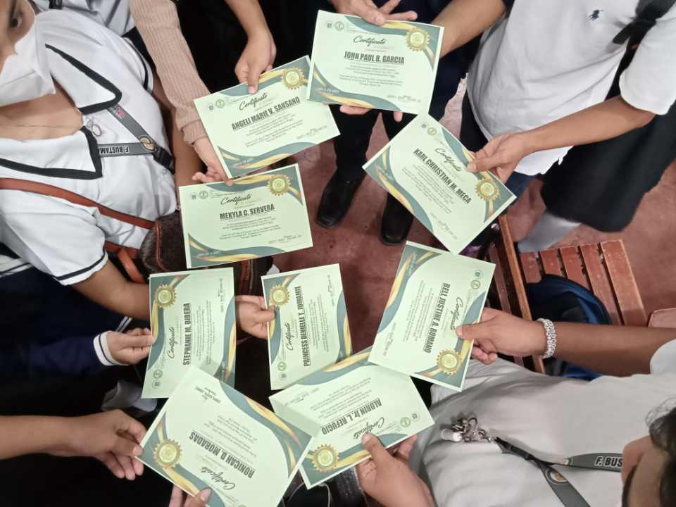

# Sir Bell Justine Romano

### Fresh BSIT Graduate • Aspiring Software Engineer

**Entry-Level Developer · Junior Developer · Continuous Learner**

[Website](https://belljustine.github.io/)
[GitHub](https://github.com/belljustine)
[Email](mailto:justine_romano@sjp2cd.edu.ph)
[Figma — LookIT](https://www.figma.com/design/4FINPzTXyR00MqE3QrRefW/LookIT-Mobile-Prototype?node-id=0-1&t=USeMAP9YYHW7QzOb-1)

---

## Who Am I?

I am a **fresh BSIT graduate** building toward becoming a **software engineer**. I learn by writing real
applications — console programs, desktop apps, Java OOP projects, and browser-based tools — then breaking
them, debugging them, and rewriting them until they work.

I am at the **entry level**. I have foundational knowledge, I am comfortable picking up a language quickly,
and I am honest about what I have and have not built.

## About Me

- 🎓 **Education:** Bachelor of Science in Information Technology (**BSIT**)
- 💻 **Focus:** Software development, web development, and practical application building
- 🌱 **Approach:** Continuous learning, hands-on project work, and constant code refinement
- 🎯 **Goal:** Grow into a professional **Software Engineer**
- 📍 **Level:** Entry-level / junior developer — early in my career, building real skills

### Developer Values

| Value | What It Means In Practice |
| :--- | :--- |
| **Perseverance** | Finishing a project even when the difficult part is still unresolved |
| **Continuous Learning** | Studying documentation and other developers' code on purpose |
| **Curiosity** | Asking how a feature works internally, then testing it myself |
| **Practical Projects** | Preferring buildable projects over theory-only exercises |
| **Improving Through Mistakes** | Reading errors as information, fixing the cause instead of the symptom |

---

## Technologies I've Worked With

Listed as **experience**, not expertise.

### 💻 Programming

      

### 🛠️ Tools & Platforms

      

---

## 🌟 Featured Projects

<table>
<tr><td width="50%" valign="top">

### 01 — Binary Calculator

 `C++`

**Category:** Programming / Calculator Application

A console-based calculator built to work through number-base conversion and bit manipulation in C++.
Learning focus: translating binary logic into working code.

| Item | Status |
| :--- | :--- |
| Exact bases & operations supported | `[NEEDS VERIFICATION]` |
| Source code review | Not present in workspace |

**Links:** Repository `[ADD LINK]` · Demo `[ADD LINK]` · Screenshots `[ADD SCREENSHOTS]`

> ⚠️ **Not the same project** as the separate Visual Basic calculator files (`BINA.vb`, `DEC.vb`,
> `OCT.vb`, `HEXA.vb`). Those are kept separate and are not merged with the C++ Binary Calculator.

</td><td width="50%" valign="top">

### 02 — Enrollment System

 `C#` `Windows Forms`

**Category:** Academic Application / Desktop Application

A desktop enrollment application developed as an academic system project, handling student records
and the workflows typical of a school registrar's office.

| Item | Status |
| :--- | :--- |
| Login / Admin / Student / Faculty profiles | `[NEEDS VERIFICATION]` |
| Attendance & grades modules | `[NEEDS VERIFICATION]` |
| Storage mechanism (database / files) | `[NEEDS VERIFICATION]` |

**Links:** Repository `[ADD LINK]` · Screenshots `[ADD SCREENSHOTS]` · Demo `[ADD LINK]`

> Only features confirmed by reading the source code will be listed here.

</td></tr>

<tr><td width="50%" valign="top">

### 03 — GentleMAN Shopping System

 `Java` `OOP`

**Category:** Java / Object-Oriented Programming (Beginner / Academic)

A shopping-system project used to apply object-oriented principles in Java — modelling products,
customers, and transactions as classes and objects rather than flat procedural logic.

| Item | Status |
| :--- | :--- |
| Classes & objects | `[NEEDS VERIFICATION]` |
| Encapsulation / Inheritance / Polymorphism / Abstraction | `[NEEDS VERIFICATION]` |
| Supporting docs (`mem.jpg`, `cert.png`) | Present as documentation only |

**Links:** Repository `[ADD LINK]` · Documentation `[ADD LINK]` · Screenshots `[ADD SCREENSHOTS]`

</td><td width="50%" valign="top">

### 04 — Digital Finance Buddy

 `HTML5`
 `CSS3`
 `JavaScript`

**Category:** Web Development / Front-End Development

A browser-based personal budget tracker. Front-end only — inputs, an expense list, calculated totals,
and DOM updates handled entirely on the client side.

| Item | Status |
| :--- | :--- |
| Budget setting | `[NEEDS VERIFICATION]` |
| Expense list & calculations | `[NEEDS VERIFICATION]` |
| Backend / database | **Not claimed** — none confirmed |

**Links:** Repository `[ADD LINK]` · Live Demo `[ADD LINK]` · Screenshots `[ADD SCREENSHOTS]`

</td></tr>

<tr><td width="100%" valign="top">

### 05 — LookIT — Mobile Home Security Prototype

 `Figma` `UI/UX Design` `Mobile Prototype`

**Category:** UI/UX Design / Mobile Application Prototype

A mobile home-security application concept designed in Figma, focusing on UI/UX clarity, simple
user controls, and a voice-interaction concept for monitoring the home from a phone.

| Item | Status |
| :--- | :--- |
| Interface design & user flow | Verifiable in the Figma file |
| Prototype interactions | Verifiable in the Figma file |
| Application code | None — design prototype only |

  

</td></tr>
</table>

> **Verification note:** anything marked `[NEEDS VERIFICATION]` still needs confirmation from source code.
> Nothing is presented as verified until the relevant repository files are inspected.

---

## 🏅 Awards & Recognition

<table>
<tr><td width="66%" valign="top">

### System Certificate — Academic System Project Recognition

Certificate of recognition related to academic system and project development work.

| Item | Status |
| :--- | :--- |
| Issuing body | `[NEEDS VERIFICATION]` |
| Date awarded | `[NEEDS VERIFICATION]` |
| Competition ranking | **Not claimed** — none exists |
| Evidence file | `CERT.jpg` (contents unverified) |

  
  &nbsp;
  

Presented strictly as **academic project recognition** — no unverified titles, dates, or rankings.

</td><td width="34%" valign="top">

  

</td></tr>
</table>

---

## 📚 Currently Learning

- Programming fundamentals
- C++ — fundamentals and problem solving
- C# and Windows Forms development
- Java and object-oriented programming
- PHP for server-side web development
- Web development — HTML, CSS, JavaScript
- Software engineering concepts and design basics
- Git and GitHub workflow
- Project documentation and README writing
- Clean code practices and refactoring

## 🧠 Developer Mindset

`Learning` → `Building` → `Making Mistakes` → `Improving` → `Trying Again` → `Growing`

| Step | What Actually Happens |
| :--- | :--- |
| **Learning** | Studying one concept at a time until it makes sense |
| **Building** | Applying it in a project that produces something runnable |
| **Making Mistakes** | Runtime errors, logic bugs, and wrong approaches that looked fine on paper |
| **Improving** | Reading the error, fixing the cause, and cleaning up the code around it |
| **Trying Again** | Rewriting the broken part a different way instead of forcing the first attempt |
| **Growing** | Keeping the better version, documenting it, and moving to the next problem |

---

## 📬 Contact

| Channel | Link |
| :--- | :--- |
| **GitHub** | [github.com/belljustine](https://github.com/belljustine) |
| **Email** | [justine_romano@sjp2cd.edu.ph](mailto:justine_romano@sjp2cd.edu.ph) |
| **Figma** | [LookIT Mobile Prototype](https://www.figma.com/design/4FINPzTXyR00MqE3QrRefW/LookIT-Mobile-Prototype?node-id=0-1&t=USeMAP9YYHW7QzOb-1) |
| **LinkedIn / Portfolio** | `[ADD LATER]` |

Open to entry-level software engineering roles, internships, and collaboration on beginner-friendly projects.

---

### Built with HTML, CSS, and a lot of debugging

Quantum Shadow theme · Sir Bell Justine Romano · Fresh BSIT Graduate, Aspiring Software Engineer

